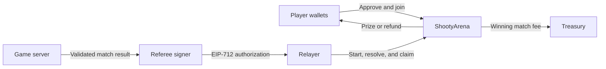

# Shooty

Smart contracts for mobile quickdraw matches and USDC payouts on Monad.

Shooty is designed for players using a BLE pistol or an on-screen controller. The game server handles inputs, scoring, and match results. The `ShootyArena` contract holds player deposits, verifies referee authorizations, and allocates prizes, fees, and refunds.

**The smart contract is deployed and source-verified on Monad Testnet.** The repository also contains the landscape web game, Python multiplayer/vision server, browser-wallet integration, and a local referee/relayer worker. Live wallet/browser validation is separate from local tests; this is a hackathon testnet prototype.

[View contract](https://testnet.monadscan.com/address/0xb2877AcE468df80B6e137776d0A60D7ec4431BaF) · [Contract documentation](contracts/README.md) · [Integration guide](contracts/INTEGRATION.md)

## Run the game

Use Node.js 24+ and Python 3.14 (the pinned vision packages are tested on that version).
From the repository root:

```sh
python3 -m venv .venv
.venv/bin/python -m pip install -r requirements.txt
npm ci --ignore-scripts --no-audit --no-fund
npm run build:wallet
cd contracts
npm ci --ignore-scripts --no-audit --no-fund
cd ..
.venv/bin/python gun_service.py --web-only --host 127.0.0.1 --chain
```

Place the authorized relayer/referee signing backup in a local `.env` or provide
`--chain-key-file /absolute/path/to/backup.json`. The worker selects only keys
matching the deployed role addresses. Credential files, transaction journals and
financial recovery records are excluded from Git. Never put signing keys in the
browser. RPC/address overrides are process environment variables; see
[server instructions](server/README.md).

For a free practice session, omit `--chain` and choose **Latihan tanpa dana**.
Open `http://localhost:8080/?input=bluetooth` for a pistol or `?input=touch` for
screen controls. Android localhost testing can use `adb reverse tcp:8080 tcp:8080`
for each connected phone; use HTTPS for a remote deployment.

In Mises, enable an Ethereum-compatible browser wallet. Connect and sign in on
Monad Testnet, create/join a room, deposit **1 test USDC** per player, register each
player's own selfie, and press **Siap Duel**. The camera recognizes the opponent
automatically during play. No separate opponent-photo or manual target step is
required. Wallet popups, Bluetooth support, and camera behavior still need to be
checked on the actual browser/device combination.

Countdown waits for finalized onchain funding and start. Resolution allocates
credits; a separate claim sends tokens. The UI reports payment only after the
arena payment event and matching token transfer are finalized. Timeout refunds
use the deployed contract deadlines. Match/payment jobs persist locally so a
server restart can reconcile receipts and recover funds.

Face matching and client camera evidence are probabilistic and can be forged by
a modified client. This prototype is not an independently audited real-money
competition. Gameplay currently implements Duel 1v1; the deployed contract also
supports Team Duel and Rumble.

### Vercel frontend

`npm run build:web` creates `dist/` from an explicit list of public game assets.
The repository's `vercel.json` deploys that directory. Set the build environment
variable `SHOOTY_BACKEND_URL` to the HTTPS origin of the running game server.
Without it, local builds use the page's own origin. Models, signing keys,
financial journals and backend source are not copied into the public directory.

On the backend, set `SHOOTY_ALLOWED_ORIGINS` to the exact frontend origin
(comma-separated if needed), then start the Python service with `--chain`.
Keep one authoritative backend process and its persistent financial files
running for the demo. The current in-memory room service is not migrated into
Vercel Functions by this frontend configuration.

## Testnet deployment

| Item | Details |
| --- | --- |
| Network | Monad Testnet |
| Chain ID | `10143` |
| Arena | `0xb2877AcE468df80B6e137776d0A60D7ec4431BaF` |
| Reward token | Test USDC, 6 decimals |
| Token address | `0x534b2f3A21130d7a60830c2Df862319e593943A3` |
| Deployment | [Successful, finalized transaction](https://testnet.monadscan.com/tx/0x80405ee1a8adecdfa3dda13f54c4946d0ee518507315124a2bcc4b941da3e63f) |
| Source verification | [MonadVision](https://testnet.monadvision.com/address/0xb2877AcE468df80B6e137776d0A60D7ec4431BaF) · [Monadscan](https://testnet.monadscan.com/address/0xb2877AcE468df80B6e137776d0A60D7ec4431BaF) |

The arena is non-upgradeable and uses an immutable reward token. Deployment addresses and role assignments are recorded in [`contracts/deployment/addresses.json`](contracts/deployment/addresses.json); the receipt and explorer verification responses are in [`contracts/deployment/testnet.json`](contracts/deployment/testnet.json).

This deployment uses testnet assets. An independent security audit has not been completed.

## Game modes and economics

Each player deposits **1 test USDC**. A winning result charges a **10% fee on the match pool**.

| Mode | Players | Pool | Platform fee | Winning payout |
| --- | ---: | ---: | ---: | --- |
| Duel | 2 | 2 USDC | 0.2 USDC | 1.8 USDC to the winner |
| Team Duel | 6, split into two teams | 6 USDC | 0.6 USDC | 1.8 USDC to each of the three winning teammates |
| Rumble | 4 | 4 USDC | 0.4 USDC | 3.6 USDC to the winner |

All amounts above are test USDC. A draw or timeout refunds actual deposits in full, with no platform fee. Team Duel rewards every member of the winning team, including players eliminated during gameplay.

## How a match works

1. **Create the match.** An authorized creator seals the ordered roster, rules hash, officials, and deadlines onchain.
2. **Deposit the entries.** Each player approves the token allowance when needed and calls `joinMatch` from their own wallet, accepting the stored match terms.
3. **Authorize the start.** After all entries are funded and the server confirms player readiness, the referee signs a start authorization. A relayer submits it to the arena.
4. **Report the result.** The server validates gameplay and the referee signs the outcome. `resolveMatch` verifies that authorization and allocates prize, fee, or refund credits.
5. **Pay the beneficiaries.** The relayer calls `claimFor` for each recipient. Anyone can submit this call, and the destination is always the beneficiary entitled to the credit.

Resolution creates payment credits; token transfers occur when those credits are claimed. A failed transfer preserves the recipient's credit for retry. If a match misses its phase deadline, anyone can call `expireMatch` to make depositor refunds available.

### Application architecture

The contract exposes the following integration flow:



The **referee** signs start and result messages offchain. The **relayer** submits transactions and pays their gas. The **admin** manages roles and future official defaults; the **pauser** can halt new admissions and starts while resolution, expiry, and claims remain available.

## Quick start

### Requirements

- Node.js **24 or later** and npm.
- Foundry, including `forge` and `cast`.
- Solidity **0.8.37**, pinned in `contracts/foundry.toml`.

The contracts use OpenZeppelin Contracts **5.6.1**, with the dependency version and integrity checksum recorded in the lockfile.

```sh
git clone https://github.com/haikarure/shooty.git
cd shooty/contracts

npm ci --ignore-scripts --no-audit --no-fund
npm run build
npm test
npm run test:integration
```

Local builds and tests do not require a funded wallet or an RPC connection after dependencies and the compiler are available. Foundry can download the pinned compiler; to use an existing installation, set `FOUNDRY_SOLC` to its absolute path.

### Development commands

Run these commands from `contracts/`:

| Command | Purpose |
| --- | --- |
| `npm run build` | Compile the contracts and export the arena ABI |
| `npm test` | Run contract tests, fuzz tests, and stateful invariants |
| `npm run test:integration` | Check typed signatures, wallet provisioning, deployment recovery, and source verification tooling |
| `npm run test:gas` | Run the isolated gas benchmark scenarios |
| `npm run export:verification` | Export compiler input and reproduce the compiled bytecode locally |
| `npm run deploy:testnet` | Run live deployment checks and simulation without broadcasting |
| `npm run deploy:testnet -- --broadcast` | Deploy with the configured signer and submit explorer verification |

Deployment commands require a populated local `.env`, a configured signer, and RPC access. Follow the [deployment guide](contracts/DEPLOYMENT.md) before submitting transactions. Gas benchmark results use the local Cancun EVM schedule; see the [gas report](contracts/GAS_OPTIMIZATION.md) for their scope and reproducible measurements.

## Contract guarantees and trust model

- **Frozen terms:** roster order, entry amount, fee, rules, referee, treasury, and deadlines are fixed when a match is created.
- **Bound authorizations:** EIP-712 messages bind the signer to the chain, arena, match, and terms. EOAs and ERC-1271 contract referees are supported.
- **Protected token paths:** deposits and claims use `SafeERC20`, reentrancy protection, and exact balance-change checks. Fee-on-transfer and rebasing tokens are unsupported.
- **Independent payments:** each beneficiary has a separate credit. Failed payments can be retried while other beneficiaries continue claiming.
- **Conserved liabilities:** deposits remain accounted for as locked funds, outstanding credits, or completed payments. Tests exercise these invariants across randomized match lifecycles.

The referee is trusted to validate and report game outcomes. Its signature authenticates the server's decision; physical gameplay is validated by the application. Token issuer restrictions can also prevent transfers, in which case the affected credit remains outstanding.

Private wallet backups, populated environment files, and signed transaction journals are excluded from Git. Only public addresses, deployment records, and an environment template are distributed. See [wallet configuration](contracts/WALLETS.md) for local setup and [`.gitleaks.toml`](.gitleaks.toml) for the repository's secret-scanning rules.

## Repository layout

```text
contracts/
  src/            Arena implementation, interface, and payout mathematics
  test/           Solidity tests, stateful invariants, and Node.js integration tests
  integration/    EIP-712 message helpers
  abi/            Exported arena ABI
  tools/          Wallet, deployment, verification, and benchmark utilities
  deployment/     Public testnet addresses and deployment receipt
  benchmarks/     Recorded gas measurements and comparison data
blueprint/        Original specifications, preview, and supporting evidence
shooty-smartcontract-handoff.html
                  Original self-contained handoff and simulated game preview
```

The original blueprint is preserved as supplied. Its historical status statements describe the handoff stage; current implementation and deployment details are documented in `contracts/`.

## Documentation

- [Contract reference](contracts/README.md): economics, lifecycle, roles, deadlines, and accounting.
- [Backend integration](contracts/INTEGRATION.md): ABI, typed messages, terms commitment, events, and payment reconciliation.
- [Deployment guide](contracts/DEPLOYMENT.md): preflight checks, signing, transaction recovery, and explorer verification.
- [Gas optimization report](contracts/GAS_OPTIMIZATION.md): measured changes, limitations, and benchmark commands.
- [Wallet configuration](contracts/WALLETS.md): role responsibilities and local credential storage.
- [Original blueprint](blueprint/README.md): game flow, controller assumptions, and implementation requirements.
