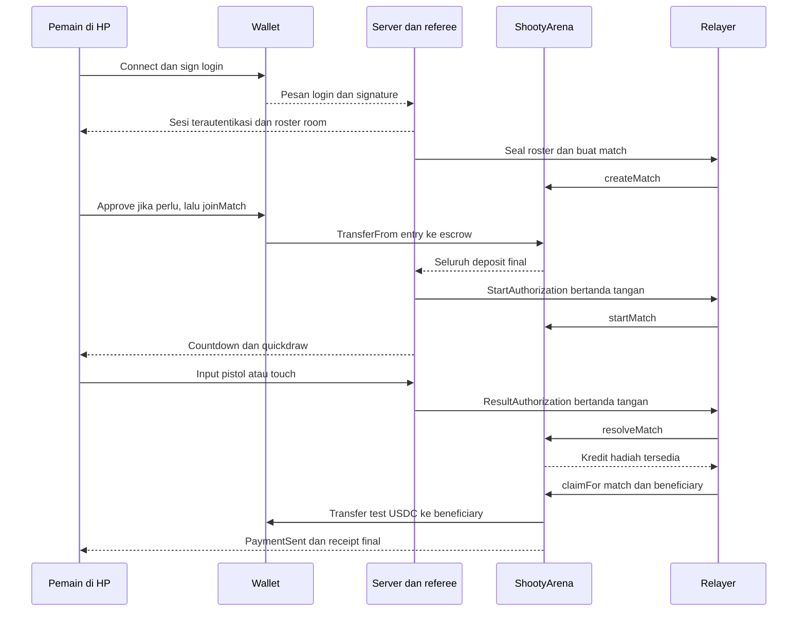
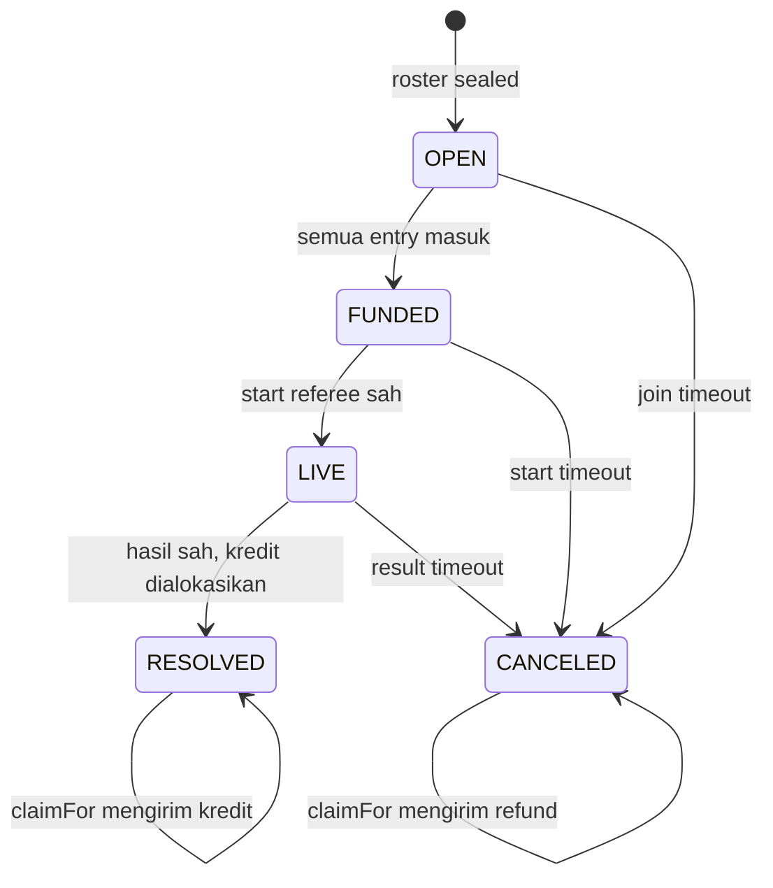

**Shooty — blueprint room, wallet, quickdraw, dan settlement**

Keputusan produk: Duel 1vs1, Team Duel 3vs3, dan Rumble empat pemain; kedua pihak memakai HP, dengan pistol BLE atau tombol layar sebagai input. Entry adalah 1 test USDC per pemain dan fee 10% dari pool pertandingan. Duel menjadi jalur demonstrasi utama. Rumble empat pemain dan entry Team Duel per pemain adalah asumsi kerja dari percakapan.

Paket ini adalah blueprint yang dapat diperiksa: [preview interaktif](index.html), [angka ekonomi](economics.json), [interface kontrak](contract-spec/src/IShootyArena.sol), [library matematika](contract-spec/src/PayoutMath.sol), dan bukti pemanggilan MCP di [openzeppelin](openzeppelin/tools.json). Preview memakai simulasi lokal; kontrak escrow, wallet, serta multiplayer belum diimplementasikan atau di-deploy. Source game yang sudah ada tidak diganti.

**Jawaban untuk “masuk room dulu, lalu sign?” adalah ya, dengan tujuan tanda tangan yang dibedakan.** Pemain dapat melihat undangan room tanpa wallet. Saat bergabung, ia connect wallet dan sign login untuk mengikat sesi server ke alamatnya. Sesudah roster terkunci dan aturan diperiksa, ia approve token bila allowance belum cukup, kemudian menandatangani transaksi joinMatch. Dana mulai terkunci ketika joinMatch sukses di chain.

| Aksi pemain | Jenis operasi | Memindahkan token? | Gas |
| --- | --- | --- | --- |
| Connect wallet | Menghubungkan akun/provider | Tidak | Tidak |
| Sign login | Pesan autentikasi offchain | Tidak | Tidak |
| Approve 1 test USDC | Transaksi allowance ERC-20 | Tidak | Test MON |
| Kunci entry dan siap | Transaksi joinMatch | 1 test USDC ke escrow | Test MON |
| Menembak | Input permainan ke server | Tidak | Tidak |
| Menerima hadiah/refund | Relayer memanggil claimFor | Escrow ke beneficiary yang tetap | Relayer membayar test MON |

Approval tidak perlu diulang jika allowance sudah cukup. Blueprint menggunakan approval sebesar kebutuhan entry, bukan unlimited. Login menggunakan nonce sekali pakai, domain, chain ID, issuedAt, dan expiry; session cookie mengikat wallet. Koneksi wallet atau string alamat di pesan WebSocket tidak menjadi bukti autentikasi. Rujukan format login adalah [ERC-4361](https://eips.ethereum.org/EIPS/eip-4361).

**Network dan token telah diperiksa dengan pembacaan RPC saja.** Pada 23 Oktober 2026, endpoint `https://testnet-rpc.monad.xyz` mengembalikan chain ID 10143. Alamat yang dicantumkan Circle untuk Monad Testnet, `0x534b2f3A21130d7a60830c2Df862319e593943A3`, memiliki kode, decimals 6, dan simbol USDC ketika diperiksa. Bukti lengkap ada di [network-check.json](network-check.json). Pemeriksaan ini bukan audit issuer, proxy, atau implementasi token. [Alamat resmi Circle](https://developers.circle.com/stablecoins/usdc-contract-addresses), [network Monad](https://docs.monad.xyz/developer-essentials/testnet).

Semua layar menunjukkan Monad Testnet. Satu test USDC tidak mempunyai nilai uang nyata. Nilai dolar dapat menjadi penjelasan nominal rancangan, tetapi saldo, entry, dan payout memakai satuan test USDC. Test MON hanya dipakai untuk gas. Tidak ada faucet, wallet, atau dana yang dibuat/dipindahkan dalam pekerjaan blueprint ini.

**Matematika kontrak memakai integer micro-USDC.** Tetapkan `ENTRY = 1_000_000`, `FEE_BPS = 1_000`, dan `BPS = 10_000`. Untuk n peserta, `pool = ENTRY × n`; `fee = floor(pool × FEE_BPS / BPS)`; `prize = pool - fee`; `perWinner = prize / jumlahPemenang`. Tiga konfigurasi tetap di bawah habis dibagi tanpa dust.

| Mode | Peserta | Pemenang | Pool | Fee | Total hadiah | Tiap pemenang |
| --- | ---: | ---: | ---: | ---: | ---: | ---: |
| Duel | 2 | 1 | 2.000.000 | 200.000 | 1.800.000 | 1.800.000 |
| Team Duel | 6 | 3 | 6.000.000 | 600.000 | 5.400.000 | 1.800.000 |
| Rumble | 4 | 1 | 4.000.000 | 400.000 | 3.600.000 | 3.600.000 |

Angka tabel adalah unit dasar enam desimal. Pemain Duel yang menerima 1,8 setelah masuk 1 mendapat hasil bersih +0,8 sebelum gas. Pada Team Duel, seluruh tiga anggota tim menang mendapat 1,8, termasuk anggota yang tereliminasi selama ronde. Payout tidak dihitung dari jumlah kill pribadi. Fee platform adalah revenue kotor, bukan profit sesudah gas dan operasi.

Saat seri atau batal, setiap peserta yang benar-benar deposit mendapat kredit refund 1. Fee nol. Jika hanya lima dari enam slot Team Duel membayar, kewajiban refund adalah 5, bukan 6. Kontrak memakai depositMask untuk membedakan slot yang terisi dengan slot yang sudah membayar. Pengubahan entry, roster, fee, atau pembagian setelah deposit pertama dilarang. Jika konfigurasi kelak diperluas, aturan rounding baru harus eksplisit dan diuji; konfigurasi blueprint ini tetap.

**Arsitektur memilih pemisahan hasil pertandingan dan transfer token.** resolveMatch menetapkan hasil serta membuat kredit hadiah/fee/refund. Sesudah itu relayer otomatis menjalankan claimFor untuk penerima. Kegagalan transfer ke satu alamat tidak boleh menghalangi penetapan hasil atau membuat hak penerima lain hilang. Pengguna tetap mengalami payout otomatis karena relayer melakukan pemanggilan tersebut; ia tidak diminta sign lagi untuk menerima.



Menerima signature hasil tidak berarti server sudah mengirim uang. Istilah UI wajib mengikuti state: hasil diverifikasi, payout diproses, lalu hadiah terkirim. Pada timeout/refund, gunakan pengembalian tersedia dan refund terkirim. Jika relayer mati setelah resolveMatch, siapa pun boleh memanggil claimFor dengan beneficiary yang tetap. Pemanggil tidak dapat mengganti alamat penerima. Wallet tetap bisa menerima transfer ketika halamannya ditutup.

**Satu kontrak escrow mendukung ketiga mode.** Kontrak diusulkan bernama ShootyArena, dengan rewardToken immutable dan implementasi awal khusus Monad Testnet. Tidak memakai proxy untuk blueprint awal. Library PayoutMath memuat quote tetap; interface di paket ini memuat bentuk ABI agar frontend/backend dapat disiapkan. OpenZeppelin tidak menyediakan logika game escrow tersebut sebagai template siap pakai.

| Komponen OpenZeppelin | Pemakaian dalam implementasi yang direncanakan |
| --- | --- |
| IERC20, IERC20Metadata, SafeERC20 | Token yang tetap, validasi decimals, transfer masuk/keluar |
| AccessControl | Creator room dan pauser; hak minimum yang eksplisit |
| Pausable | Menghentikan admission/start baru saat gangguan |
| ReentrancyGuard | Melindungi jalur token dan klaim |
| EIP712, SignatureChecker | Domain dan signature referee yang terikat ke match |
| Math.mulDiv | Perhitungan basis points dengan integer |

Template MCP memberikan AccessControl dan Pausable. SafeERC20, ReentrancyGuard, EIP712, SignatureChecker, dan logika escrow harus ditambahkan serta diuji pada implementasi nanti. Referensi API: [ERC-20](https://docs.openzeppelin.com/contracts/5.x/api/token/erc20), [access](https://docs.openzeppelin.com/contracts/5.x/api/access), [utils](https://docs.openzeppelin.com/contracts/5.x/api/utils), [cryptography](https://docs.openzeppelin.com/contracts/5.x/api/utils/cryptography).

Admin tidak mempunyai fungsi menarik escrow pemain, mengganti hasil yang sudah resolved, atau mengubah aturan match aktif. Pause memblokir createMatch, joinMatch, dan startMatch. resolveMatch pada pertandingan LIVE, expireMatch, serta claimFor tetap tersedia. Saldo token yang dikirim langsung ke alamat kontrak tidak otomatis menjadi pool match. Fungsi penyapuan rewardToken tidak disediakan dalam rancangan awal.

Referee dan feeRecipient disalin ke record saat createMatch. Rotasi konfigurasi global berlaku untuk match berikutnya, bukan mengubah signer atau penerima fee match yang sudah didanai. Referee tetap pihak terpercaya yang menentukan kejadian game; signature tidak membuktikan aim fisik. Pembatasan hak admin tidak menghilangkan kepercayaan pada keputusan referee.

**Roster dikunci sebelum kontrak menerima dana.** Private room awalnya hidup di server. Peserta bergabung dengan sesi login yang valid; controller dan kesiapan perangkat diperiksa. Saat roster lengkap, relayer membuat record onchain. Mode Duel mengharuskan dua alamat unik, Team Duel enam, dan Rumble empat. Alamat nol dan duplikasi ditolak. Team Duel memakai slot 0–2 untuk Alpha dan 3–5 untuk Bravo.

rosterHash adalah `keccak256(abi.encode(roster))`; urutan alamat termasuk dalam komitmen. termsHash memakai abi.encode dengan tag versi, chainId, alamat arena, matchId, mode, rosterHash, token, entry, feeBps, feeRecipient, referee, rulesHash, joinDeadline, startDeadline, maxPlaySeconds, dan resultGraceSeconds. Encoding ABI dan urutan tipe harus sama pada Solidity serta backend. matchId unik dan tidak pernah dipakai ulang.

Frontend membaca terms dari kontrak dan mencocokkan termsHash dengan halaman room sebelum meminta deposit. joinMatch menerima expectedTermsHash, memeriksa msg.sender sebagai salah satu peserta, lalu menarik entry dari msg.sender itu sendiri. Allowance yang pernah diberikan tidak memberi server hak mendepositkan pengguna tanpa panggilan join dari pengguna. Saldo token masuk harus bertambah tepat sebesar ENTRY; token dengan perilaku potongan/rebase tidak didukung.

**Join juga menyatakan pemain siap menurut aturan yang ditampilkan.** Tombolnya “Kunci 1 test USDC & siap”. Tidak ada signature readiness tambahan per ronde. Server hanya menerbitkan start setelah seluruh deposit final dan seluruh client kembali aktif dengan controller siap. Ketika wallet mobile mengambil foreground, game menunggu pengguna kembali; jangan memulai duel saat pengguna masih berada di aplikasi wallet.

| Fungsi rancangan | Pemanggil | Preconditions dan hasil |
| --- | --- | --- |
| createMatch | ROOM_CREATOR_ROLE melalui relayer | Roster unik sesuai mode, deadline valid, terms dipatok; state OPEN |
| joinMatch | Peserta yang bersangkutan | OPEN, belum deposit, sebelum joinDeadline, expectedTermsHash cocok; satu entry ditarik |
| startMatch | Siapa pun membawa signature referee | FUNDED, sebelum startDeadline, StartAuthorization benar; state LIVE |
| resolveMatch | Siapa pun membawa signature referee | LIVE, sebelum resultDeadline dan signature expiry; WIN/DRAW mengalokasikan kredit |
| expireMatch | Siapa pun | Deadline fase terlewati; match yang belum resolved berubah CANCELED dan mengalokasikan refund |
| claimFor | Siapa pun | Hanya membayar kredit beneficiary yang tetap; kredit nol menjadi no-op |



Status terminal RESOLVED/CANCELED tidak berubah menjadi match baru. Status pengiriman uang dilacak melalui kredit setiap beneficiary dan PaymentSent. Frontend tidak menganggap terminal match sama dengan semua payout sudah dibayar.

Usulan deadline awal untuk demo: join selama 180 detik dari create; startDeadline adalah joinDeadline ditambah 60 detik. Server dapat memulai segera setelah semua siap. Sejak startMatch, maksimum permainan 120 detik, lalu grace hasil 120 detik; resultDeadline ditetapkan sekali menjadi waktu start ditambah 240 detik. Parameter ini rancangan, belum hasil pengukuran perangkat. Deadline disimpan pada chain dengan detik, bukan mengandalkan timer browser.

join/start/resolve menerima transaksi tepat pada deadline (`<=`); expire baru sah sesudahnya (`>`). State terminal mencegah settlement dan refund kedua. Result yang terlambat tidak boleh menimpa cancellation. Sesi terputus tidak memberi client wewenang meminta pembatalan sepihak setelah mengetahui ia kalah. Aturan forfeit/reconnect harus termasuk rulesHash.

**Otorisasi start dan hasil memakai pesan berbeda.** Domain EIP-712 yang direncanakan adalah name ShootyArena, version 1, chainId 10143, dan verifyingContract alamat deployment. Nama tipe dibedakan agar signature start tidak dapat menjadi signature payout.

```text
StartAuthorization(bytes32 matchId,bytes32 termsHash,uint64 validUntil)
ResultAuthorization(bytes32 matchId,bytes32 termsHash,uint8 outcome,
                    uint8 winner,bytes32 resultsHash,uint64 validUntil)
```

Outcome WIN=0 dan DRAW=1 mengikuti interface. Untuk Duel/Rumble, winner adalah indeks roster yang sah. Untuk Team Duel, winner hanya 0 atau 1 dan kontrak memilih ketiga slot tim terkait. Untuk DRAW, winner harus 0 dan jumlah refund hanya mengikuti deposit. resultsHash berkomitmen pada log/hasil server; ia tidak menyimpan video atau membuktikan bahwa log itu benar. Validasi signature memakai referee yang telah dipatok pada match. Domain, termsHash, matchId unik, deadline, dan state terminal bersama-sama mencegah replay lintas match/chain/kontrak.

**Konservasi dana harus berlaku sepanjang seluruh match.** Deposit menambah locked match dan totalLiability. resolve/expire mengubah locked menjadi kredit tanpa mengurangi totalLiability. claimFor mengurangi kredit serta totalLiability sebesar token yang benar-benar ditransfer. Jika transfer revert, pengurangan kredit ikut revert sehingga hak penerima tetap ada. Jalur ini memakai checks-effects-interactions dan nonReentrant.

```text
tokenBalance(arena) >= totalLiability

Untuk setiap match:
totalDeposit = lockedBelumDialokasikan + kreditBelumDikirim + totalTerkirim

WIN:
jumlahKreditPemenang + kreditFee = totalDeposit

DRAW / TIMEOUT:
jumlahKreditRefund = totalDeposit; kreditFee = 0
```

Fee treasury juga kewajiban sampai ditransfer. Jika treasury kebetulan sama dengan salah satu pemain, kredit harus dijumlahkan (`+=`), bukan menimpa kredit hadiah. State terminal ditetapkan sebelum alokasi selesai secara atomik dan tidak dapat diproses ulang. Untuk Team Duel semua anggota roster pemenang mendapat bagian yang sama, terlepas dari status eliminasi individu.

**Desain layar berorientasi dua HP.** Preview interaktif menyediakan delapan tahap yang bisa diklik sebagai screen explorer. Semua signature, saldo, hasil duel, dan receipt di preview adalah simulasi. Label ini tetap terlihat pada layar agar tidak disalahartikan sebagai koneksi atau pembayaran nyata.

| Tahap | Informasi utama | Aksi dan status |
| --- | --- | --- |
| Landing | Duel utama, Team Duel, Rumble; entry, hadiah dan fee | Pilih mode, buat/masuk private room |
| Wallet | Akun, jaringan 10143, saldo USDC dan MON | Connect, sign login, funding guidance bila saldo kurang |
| Room | Kode undangan, roster dan tim, pilihan pistol/touch | Kalibrasi controller; cek aturan dan terms |
| Entry | Token/spender, nominal 1, fee dan payout | Approve bila perlu, lalu kunci entry; status tiap depositor |
| Ready | Pool aktual, seluruh pemain funded dan aktif | Countdown setelah startMatch final |
| Duel | Aba-aba, lawan virtual, ronde, status koneksi | Input piston/touch; server menentukan eliminasi |
| Result | Hasil resmi, kredit hadiah/refund | Payout diproses oleh relayer; tampilkan retry yang aman bila gagal |
| Paid | Total diterima, entry, hasil bersih, receipt | Explorer, kembali ke lobby, rematch dengan persetujuan baru |

Gaya visual yang dipilih: arcade quickdraw dengan latar gelap, aksen tembaga untuk aksi, ungu untuk network Monad, dan tipografi sistem yang jelas. Tombol sentuh minimum 44 px, kontras status harus cukup, dan informasi fee tidak disembunyikan dalam tooltip. Pistol/touch mengikuti cooldown dan damage yang sama. Avatar virtual adalah bagian simulasi; pelacakan tubuh lawan fisik belum dibuat.

Jalur mobile yang perlu dibuktikan adalah Chrome Android untuk Web Bluetooth dan koneksi wallet mobile melalui jalur connector yang sesuai. Dukungan BLE tidak boleh diasumsikan tersedia di semua browser dalam aplikasi wallet. Web Bluetooth memerlukan secure context dan pemilihan perangkat melalui aksi pengguna. Uji alur kembali dari aplikasi wallet sebelum mengunci readiness. Rujukan: [Chrome Web Bluetooth](https://developer.chrome.com/docs/capabilities/bluetooth), [Reown AppKit JavaScript](https://docs.reown.com/appkit/javascript/core/installation). Blueprint tidak memasang connector atau membuka wallet pengguna.

**Server dan relayer mempunyai kontrak integrasi yang jelas.** Endpoint usulan adalah POST /auth/nonce, POST /auth/verify, POST /rooms, POST /rooms/:id/join, POST /rooms/:id/seal, GET /matches/:id, serta WebSocket untuk presence/input. Identity WebSocket berasal dari sesi auth; playerId diturunkan server, bukan dipercaya dari payload. Input pistol yang sekarang disiarkan global harus diarahkan ke room dan pemain pemiliknya.

Event client yang diusulkan adalah CONTROLLER_READY, SHOT, dan RECONNECT. Event server adalah ROSTER_LOCKED, ENTRY_CONFIRMED, MATCH_STARTING, DRAW_SIGNAL, SHOT_ACCEPTED/REJECTED, PLAYER_ELIMINATED, ROUND_ENDED, MATCH_RESULT, PAYMENT_PENDING, dan PAYMENT_CONFIRMED. Event chain dipakai untuk deposit dan pembayaran; score client tidak menjadi otorisasi keuangan.

Relayer menyimpan job berdasarkan chainId, arena, matchId, aksi, dan beneficiary. Nonce transaksi dikelola konsisten. Timeout RPC bukan bukti transaksi gagal; rekonsiliasi state/receipt sebelum retry. PaymentConfirmed membutuhkan receipt sukses, token/receiver/jumlah yang benar, dan finality yang sesuai. Monad membedakan data latest dan finalized; rekonsiliasi finansial dapat mempertimbangkan tahap Verified. [Referensi RPC Monad](https://docs.monad.xyz/reference/json-rpc/overview).

**Pemakaian MCP dapat ditelusuri.** Endpoint resmi `https://mcp.openzeppelin.com/contracts/solidity/mcp` mengidentifikasi diri sebagai OpenZeppelin Solidity Contracts MCP Server versi 0.7.2. Panggilan nyata adalah solidity-custom untuk ShootyArenaBase dengan roles/pausable, serta solidity-erc20 untuk ShootyLocalTestToken enam desimal bagi pengujian lokal saja. Source asli dan JSON request/response disimpan tanpa modifikasi di openzeppelin/. Tidak ada registrasi MCP permanen atau server lokal yang dibiarkan berjalan. [MCP resmi](https://mcp.openzeppelin.com/), [source server resmi](https://github.com/OpenZeppelin/openzeppelin-mcp).

Ada perbedaan versi yang perlu dicatat: komentar source hasil MCP menyebut kompatibel dengan Contracts ^5.7.0, sedangkan versi npm stabil yang dikembalikan ketika diperiksa adalah 5.6.1. Blueprint mengunci dependency 5.6.1, mempertahankan source hasil MCP asli, dan mengompilasi template terpilih terhadap dependency tersebut. Ini bukti compile untuk template yang dipakai, bukan pernyataan kompatibilitas semua API 5.7 atau audit escrow.

Pengujian yang tersedia mencakup quote tiga mode, pembagian pool, fee, refund penuh/parsial, seluruh mask deposit yang sah, penolakan mode/mask tidak sah, dan fuzz konservasi pool pada library matematika. Interface serta template MCP juga ikut dikompilasi. Test library tidak menguji implementation escrow karena implementation tersebut belum dibuat. [Petunjuk verifikasi](contract-spec/README.md).

Acceptance untuk tahap implementasi berikutnya: dua HP memakai wallet berbeda; pistol hanya menembakkan pemain pemiliknya; UI membedakan login/allowance/deposit; dua deposit final mengaktifkan start; hasil signed tidak dapat diarahkan ke outsider; replay tidak menambah kredit; payout otomatis mentransfer ke beneficiary tetap; timeout mengembalikan depositor tanpa fee; claim dapat dilakukan meski admission di-pause atau relayer pertama mati; refresh memuat state chain yang benar. Setelah Duel lengkap, buktikan pembagian tiga penerima Team Duel dan eliminasi empat peserta Rumble.
