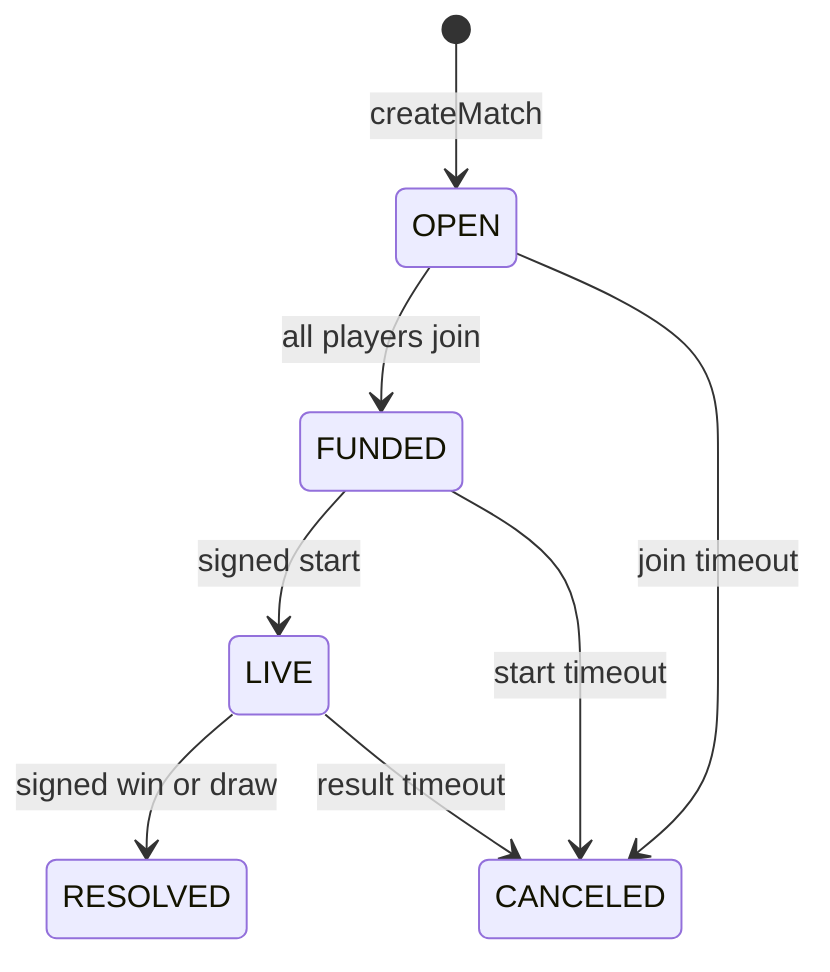

# Shooty contracts

`src/ShootyArena.sol` implements the supplied handoff's escrow for **Monad Testnet, chain 10143**. Deployment on another chain reverts. The contract has no proxy and its reward token is immutable. The arena is deployed at **`0xb2877AcE468df80B6e137776d0A60D7ec4431BaF`**, with a finalized successful receipt and verified source on [MonadVision](https://testnet.monadvision.com/address/0xb2877AcE468df80B6e137776d0A60D7ec4431BaF) and [Monadscan](https://testnet.monadscan.com/address/0xb2877AcE468df80B6e137776d0A60D7ec4431BaF). The public addresses and role assignments are in `deployment/addresses.json`.

The extracted starter remains unchanged in `../blueprint/contract-spec/`. MCP files in `src/generated/` are reference templates; the escrow imports OpenZeppelin directly. `LOCALUSD` and the adversarial test token are local fixtures, not Circle USDC.

## Build and check

Requirements: Node.js 22+, Foundry, and Solidity **0.8.37**. OpenZeppelin Contracts is pinned to **5.6.1** with its original npm integrity checksum. Compiler settings: optimization with 200 runs, via IR, Cancun.

```sh
cd contracts
npm ci --ignore-scripts --no-audit --no-fund
npm run build
npm test
npm run test:integration
```

Foundry downloads the pinned compiler if necessary. To use an existing local compiler, set `FOUNDRY_SOLC` to its absolute path or pass `--use /path/to/solc` to Forge. This implementation was checked using Foundry 1.8.1 and solc `0.8.37+commit.f401782d`.

`abi/ShootyArena.json` is exported from the compiled implementation, including constructor, roles, errors, events, and inherited methods. Re-export after ABI changes with `node tools/export-abi.mjs`.

## Economics and lifecycle

Amounts are integer micro-USDC with six decimals. Entry is 1,000,000 units per participant. The fee is 1,000 basis points, taken only on a win.

| Mode | Roster | Fee | Winning credits |
| --- | --- | --- | --- |
| DUEL = 0 | 2 unique addresses | 200,000 | 1,800,000 to one slot |
| TEAM_DUEL = 1 | 6 unique addresses | 600,000 | 1,800,000 to each of 3 teammates |
| RUMBLE = 2 | 4 unique addresses | 400,000 | 3,600,000 to one slot |

Team Alpha occupies slots 0–2, Bravo 3–5. Team Duel uses winner index 0/1 for the entire team, irrespective of individual eliminations. Other modes use a roster index. Outcome WIN = 0; DRAW = 1 requires winner 0. Draws/timeouts refund actual depositors in full with no fee.



Claims pay individual credits without changing terminal state. Anyone can call `claimFor(matchId, beneficiary)`, with funds always going to that beneficiary. A zero credit is a no-op; a failed transfer leaves its credit available for retry.

Join, start, and resolve are valid at the exact deadline (`<=`); expiry requires strictly later (`>`). At start, the result deadline is set once to current time + 120 play seconds + 120 grace seconds. The suggested frontend defaults are join in 180 seconds and start 60 seconds later. Creation requires a future join deadline, a strictly later start deadline, and room for the result deadline in `uint64`. Early unilateral cancellation is unavailable.

## Roles and frozen terms

Constructor argument order:

```solidity
constructor(address token, address admin, address creator, address pauser, address referee, address feeRecipient)
```

`DEFAULT_ADMIN_ROLE` manages roles and future official defaults. `ROOM_CREATOR_ROLE` creates sealed rosters. `PAUSER_ROLE` controls admission/start pause. Signatures are verified against the stored referee, supporting EOAs and ERC-1271 contracts; referees do not need an AccessControl role.

`setDefaultOfficials` affects future matches only. Creation freezes roster order, rules, token, entry, fee, officials, and deadlines, even before funding. Zero/duplicate roster addresses, arena as player/treasury, zero match ID/rules hash, and invalid deadlines are rejected. IDs cannot be reused after settlement or cancellation.

Pause blocks create/join/start. Resolution of LIVE games, expiry, and claims remain available. The admin has no withdrawal, credit redirection, active-terms mutation, result override, or reward-token sweep method. Direct donations stay outside match pools.

## Accounting and trust

```text
Per match: totalDeposited = locked + outstanding credits + totalPaid
Global:   totalLiability = sum(locked + outstanding credits)
          rewardToken.balanceOf(arena) >= totalLiability
```

Deposits increase liabilities; settlement reallocates locked funds into credits; successful claims reduce both credit and liability. Treasury fees remain liabilities until paid. A winner who is also the treasury receives the sum.

`SafeERC20` and `nonReentrant` protect token paths. Deposits must increase arena balance by exactly entry. Claims must decrease arena balance and increase beneficiary balance by exactly the credit. Fee-on-transfer, rebasing, and dishonest balance-reporting tokens are unsupported. The issuer can still block transfers. The referee is trusted to report game results; its signature does not prove physical gameplay.

Tests cover payouts/refunds, roles, signatures/domains/replay, inclusive deadlines, pause, ERC-1271, transfer failure/retry, reentrancy, donations, simultaneous matches, and stateful accounting invariants. Forge gas figures use Cancun EVM costs and are not Monad gas quotes.

Measured improvements and reproducible per-operation benchmarks are in [GAS_OPTIMIZATION.md](GAS_OPTIMIZATION.md). Run `npm run test:gas` for the isolated benchmark suite. `MatchCreated.mode` is now indexed; event consumers must use the regenerated ABI.

## Integration and deployment preparation

[INTEGRATION.md](INTEGRATION.md) specifies the ABI, messages, terms encoding, events, and reconciliation. `integration/authorizations.mjs` returns payloads for a standard EIP-712 signer. No frontend, game server, or running relayer is included in this workspace.

Fill the public role addresses in `.env.example`, without a private key:

```sh
cp .env.example .env
# Fill .env, then:
node --env-file=.env tools/prepare-deployment.mjs
```

The script checks chain ID, token code, and six decimals at one finalized block, then writes constructor arguments/init code to `deployment/prepared.json`. It sends no transaction and does not establish issuer/proxy safety. The candidate test USDC address comes from [Circle's official testnet list](https://developers.circle.com/stablecoins/usdc-contract-addresses). Live RPC checks must succeed before deployment.

Run `npm run export:verification` to prepare `deployment/verification/standard-input.json`, `metadata.json`, and a manifest for explorer verification. This command checks every source against the compiled artifact, recompiles the exported input, and requires exact creation/runtime bytecode matches. It needs local `cast` and `solc` (or `FOUNDRY_SOLC` pointing at the pinned compiler), uses no wallet/RPC, and leaves the deployment address unset. `--output /path/to/directory` selects an alternate destination. Fill the real deployed address and constructor arguments in the verification API request only after a confirmed deployment.

`--offline` produces a review artifact labeled `UNVERIFIED_OFFLINE`; it does not replace live checks. `--output /path/to/file.json` selects the output. Missing role addresses fail preparation.

The owner requested local wallets with exportable private keys for this demo. [WALLETS.md](WALLETS.md) lists their roles, the public address manifest, and the protected backup location. The generated `.env` is already populated with public role addresses. This local wallet setup follows that explicit request; it does not create an Alchemy session.

For the owner-requested local signer, use [DEPLOYMENT.md](DEPLOYMENT.md): `npm run deploy:testnet` performs live checks, and `npm run deploy:testnet -- --broadcast` signs only after those checks succeed. The script uses the canonical CreateX factory, preserves a transaction journal for retries, checks finalized deployment state, and submits the monskills verification request. The Alchemy session workflow remains an alternative signer setup if selected later. The completed deployment is recorded in `deployment/testnet.json`; `.env` now includes its `ARENA_ADDRESS` for backend integration.

References: [Monad Testnet](https://docs.monad.xyz/developer-essentials/testnet), [gas pricing](https://docs.monad.xyz/developer-essentials/gas-pricing), [OpenZeppelin cryptography](https://docs.openzeppelin.com/contracts/5.x/api/utils/cryptography).
